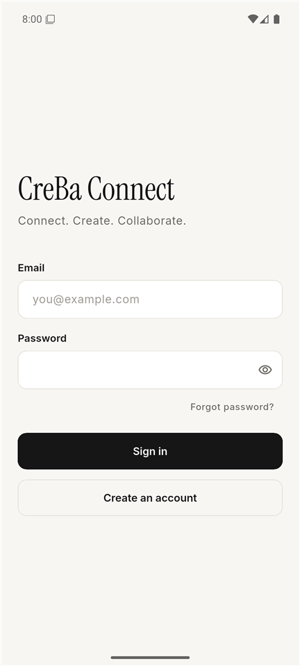
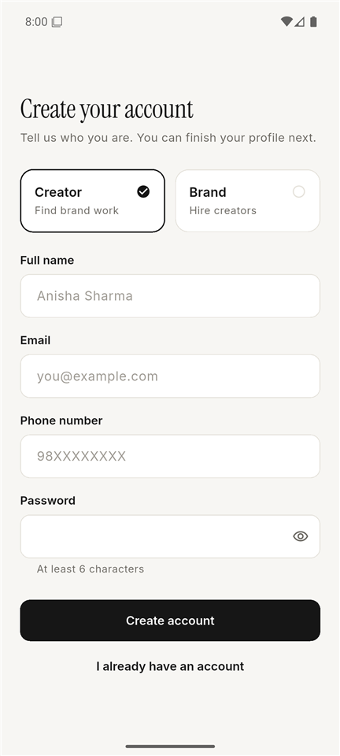
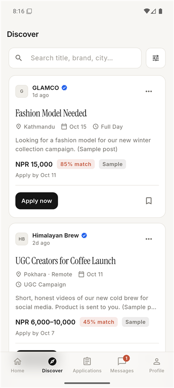
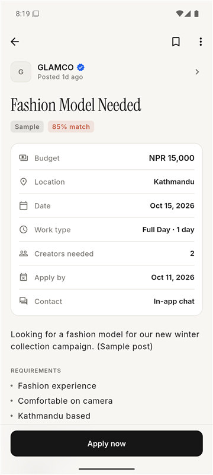
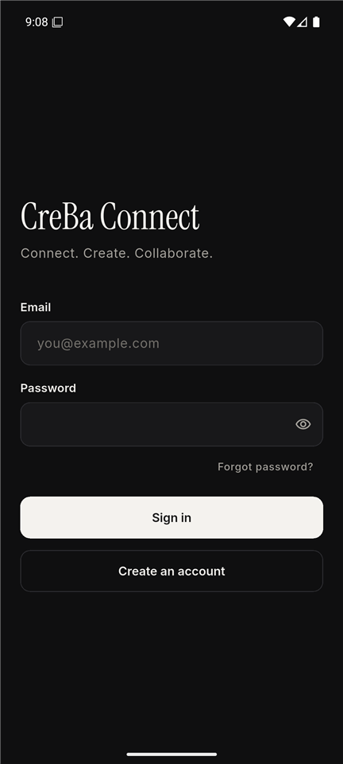

# CreBa Connect

**Connect. Create. Collaborate.** — *Where Brands Meet Creators.*

CreBa Connect (**Cre**ator + **B**r**a**nd Connector) is a two-sided mobile platform for Nepal. Brands discover models, influencers, UGC creators, photographers and other creative professionals; creators build a professional profile, find paid opportunities and apply to them.

Built with **Flutter**, **Firebase Authentication**, **Cloud Firestore** and **Provider**.

---

## Contents

1. [Features](#features)
2. [Technology stack](#technology-stack)
3. [Architecture](#architecture)
4. [College assignment mapping](#college-assignment-mapping)
5. [Screenshots](#screenshots)
6. [Running the project](#running-the-project)
7. [Windows setup](#windows-setup)
8. [Firebase setup](#firebase-setup)
9. [Firestore structure](#firestore-structure)
10. [Security rules](#security-rules)
11. [Admin and demo accounts](#admin-and-demo-accounts)
12. [Testing](#testing)
13. [GitHub](#github)
14. [Known limitations](#known-limitations)
15. [Future improvements](#future-improvements)

More documents: [testing checklist](docs/TESTING_CHECKLIST.md) · [viva notes](docs/VIVA_NOTES.md)

---

## Features

### For creators
- Sign up, then a five-step onboarding: creator type, niches, city, bio, links
- Professional profile with multiple creator types and niches, skills, languages, rate, social links and portfolio
- **Discover** — a live feed of brand opportunities with search and filters
- **Best Fit** score on every opportunity (rule-based, "based on your profile")
- Apply with a message and a proposed rate; withdraw; re-apply
- Track applications by stage: Applied → Shortlisted → In Discussion → Selected / Rejected
- Availability posts: create, edit, pause and delete
- Save opportunities and brands
- Real-time chat with brands
- Dashboard: profile completeness, applications, shortlisted, selected, saved, profile views

### For brands
- Sign up, then a six-step onboarding including PAN details for verification
- **Hire a Creator** — post an opportunity with type, niches, location, date, budget (fixed, range or negotiable), requirements and deliverables
- Edit, close, reopen and delete opportunities
- **Discover creators** with search and filters (type, niche, city, rate, work type, language, gender, availability) and a Best Fit score
- Browse creators' availability posts
- Home sections: Best fit for you, Trending, Rising, Popular in your category, Recently active
- Review applicants and move them through stages; the creator is notified
- Invite a creator to an opportunity; save creators
- Real-time chat with creators
- Dashboard: active opportunities, applications, saved creators, post performance

### For admins
- Users: view creators and brands, suspend or reactivate, set a plan
- Verification: review PAN details and verify or reject a brand
- Content: view and remove hiring posts and creator posts; resolve or dismiss reports
- Payments: promotion requests, payment records, subscriptions
- Categories: edit creator types, niches and business categories
- Analytics: user, post, application and active-user counts
- Sample data: add or remove clearly-labelled demo brands, creators and posts

### For everyone
- Email and password accounts with persistent sign-in
- Custom light and dark themes, switchable at runtime and remembered
- NPR by default, with approximate USD display
- In-app notifications, live
- Report a profile or post
- Responsive layout for small phones up to tablets

---

## Technology stack

| Area | Choice |
|---|---|
| Framework | Flutter 3.47 (Dart 3.13) |
| Authentication | Firebase Authentication (email and password) |
| Database | Cloud Firestore |
| State management | Provider |
| Local preferences | shared_preferences (theme, currency) |
| Formatting | intl |
| Links | url_launcher |

That is the complete list of runtime packages. See [`pubspec.yaml`](pubspec.yaml).

---

## Architecture

Four layers. Each layer only talks to the one directly below it.

```
SCREENS / WIDGETS   what the user sees. No Firebase code here.
        │  reads state, calls methods
PROVIDERS           hold app state, loading and error flags, notify the UI
        │  call
SERVICES            the only place that talks to Firebase
        │  read / write
FIREBASE            Authentication · Cloud Firestore

MODELS              typed data classes (fromJson / toJson) used by every layer
```

```
lib/
├── main.dart               starts Firebase, then the app
├── app.dart                registers providers, applies the theme, shows AuthGate
├── firebase_options.dart   generated by FlutterFire
├── models/                 AppUser, CreatorProfile, BrandProfile, HiringPost,
│                           AvailabilityPost, JobApplication, Conversation, Message,
│                           AppNotification, Favorite, Report, Promotion, enums, filters
├── services/               one class per area; every Firestore/Auth call lives here
├── providers/              one ChangeNotifier per area
├── theme/                  AppPalette (colours), AppTheme (light + dark ThemeData)
├── screens/
│   ├── auth/               AuthGate, sign in, sign up
│   ├── onboarding/         creator and brand onboarding
│   ├── creator/            home, feed, applications, availability, edit profile
│   ├── brand/              home, discover, posts, applicants, verification
│   ├── shared/             job detail, creator profile, brand profile
│   ├── chat/ notifications/ settings/ promotion/ admin/
├── widgets/                reusable UI: AppButton, AppTextField, cards, badges, …
└── utils/                  validators, formatters, Best Fit and trending scoring
```

### Providers

| Provider | Holds |
|---|---|
| `AuthProvider` | signed-in / signed-out state, from `authStateChanges()` |
| `UserProvider` | the account record: role, onboarding, active |
| `ThemeProvider` | Light / Dark / System, saved on the device |
| `SettingsProvider` | display currency |
| `CategoryProvider` | editable option lists |
| `CreatorProvider` | own profile; creator list and filters |
| `BrandProvider` | own brand and verification; brand list |
| `HiringPostProvider` | opportunity feed or own posts; filters |
| `AvailabilityProvider` | availability posts |
| `ApplicationProvider` | applications sent or received |
| `ChatProvider` | conversations, open chat, unread count |
| `NotificationProvider` | notifications, unread count |
| `FavoritesProvider` | saved items |
| `PromotionProvider` | promotion requests, plan |
| `AdminProvider` | everything in the admin area |

Data providers extend `SessionProvider`: they start listening when a user signs in and clear themselves on sign-out, so one account never sees another's leftover data.

### Auth flow

```
App starts → Firebase.initializeApp()
           → AuthProvider listens to authStateChanges()
               signed out → Sign in / Sign up
               signed in  → load users/{uid}
                              suspended           → notice + sign out
                              role = admin        → Admin area
                              onboarding not done → Onboarding
                              role = creator      → Creator app
                              role = brand        → Brand app
```

`AuthGate` is the only entrance to the app, so there is no route by which a signed-out user can reach a protected screen. The security rules enforce the same thing on the server.

---

## College assignment mapping

| Requirement | Where it is |
|---|---|
| **Firebase Authentication** — sign up, sign in, sign out | `services/auth_service.dart`, `providers/auth_provider.dart`, `screens/auth/` |
| Persistent authentication state | `AuthService.uidChanges` (wraps `authStateChanges()`); Firebase restores the session on launch |
| Unauthenticated users blocked | `screens/auth/auth_gate.dart` + `firestore.rules` |
| Auth state managed outside widgets | `AuthProvider` and `UserProvider`; screens only read them |
| **Firestore — Create** | profile, hiring post, availability post, application, message, favourite, report |
| **Firestore — Read** | live opportunity feed, creator list, profiles, applications, chat, notifications |
| **Firestore — Update** | edit profile, edit / close post, application status, pause availability |
| **Firestore — Delete** | hiring post, availability post, saved item, notification |
| CRUD linked to the user's UID | profile document ID = UID; `brandId` / `creatorId` / `userId` on every owned document; enforced by rules |
| **Provider** state management | `lib/providers/` — 15 providers, no BLoC or Riverpod |
| No Firebase calls in widgets | all Firebase code is in `lib/services/` |
| **Light and dark theme** | `AppTheme.lightTheme`, `AppTheme.darkTheme` in `theme/app_theme.dart` |
| Runtime switching, persisted | `ThemeProvider` + `shared_preferences`; Settings → Theme |
| Switching does not reset state | only `MaterialApp`'s theme mode changes; see `_ThemedApp` in `app.dart` |
| Folder structure | `models/ services/ providers/ theme/ screens/ widgets/ utils/ main.dart` |
| Validation, loading, empty, error states | `utils/validators.dart`, `widgets/state_views.dart`, `utils/app_exception.dart` |

The quickest demonstration of all four CRUD operations is the brand's **Opportunities** tab.

---

## Screenshots

| Sign in | Sign up | Discover feed | Opportunity | Dark mode |
|---|---|---|---|---|
|  |  |  |  |  |

The feed and opportunity screens show the app's built-in sample data, which is fictional.

To capture more from a running emulator:

```bash
adb exec-out screencap -p > docs/screenshots/home.png
```

---

## Running the project

```bash
git clone https://github.com/karujan23-ai/creba-connect.git
cd creba-connect
flutter pub get
flutter run
```

`flutter run` starts the app on the connected phone or running emulator. To pick a device: `flutter devices`, then `flutter run -d <device id>`.

### Shortcuts on Windows

The `tools` folder has double-click helpers for this laptop's setup:

| File | What it does |
|---|---|
| `tools\start-phone.cmd` | starts the virtual Android phone |
| `tools\run-app.cmd` | builds and runs the app on the phone |
| `tools\firebase-sign-in.cmd` | signs the Firebase CLI in |
| `tools\push-to-github.cmd` | uploads the project to GitHub |
| `tools\run-e2e.ps1` | runs the end-to-end test |

### Installable APK

```bash
flutter build apk --release
```

The file appears at `build\app\outputs\flutter-apk\app-release.apk` and can be copied to any Android phone. It is signed with the debug key, which is fine for a demo but not for the Play Store.

### Running against the local emulators

The app can run against the Firebase Local Emulator Suite, a pretend Firebase on your own computer. Nothing done in this mode touches the real project's data, which makes it the safe place for experiments and automated tests.

```bash
firebase emulators:start --only auth,firestore
```

Then, in a second terminal:

```bash
flutter run --dart-define=USE_FIREBASE_EMULATOR=true
```

---

## Windows setup

| Software | Purpose |
|---|---|
| [Git for Windows](https://git-scm.com/download/win) | required by Flutter; used for GitHub |
| [Flutter SDK](https://docs.flutter.dev/get-started/install/windows) | the framework (includes Dart) |
| [Android Studio](https://developer.android.com/studio) | Android SDK, emulator and Java |
| [VS Code](https://code.visualstudio.com/) + Flutter extension | editor |
| [Node.js LTS](https://nodejs.org/) | required by the Firebase CLI |
| Firebase CLI | `npm install -g firebase-tools` |
| FlutterFire CLI | `dart pub global activate flutterfire_cli` |

Check the installation:

```bash
flutter doctor
```

Every line except "Visual Studio" should have a tick. Visual Studio is only needed for Windows desktop apps, which this project does not build.

**Keep the project outside OneDrive** (for example `C:\dev\creba_connect`). OneDrive locks build files while syncing, which makes builds fail at random.

---

## Firebase setup

This repository is already connected to the Firebase project **`creba-connect`** (Firestore in `asia-south1`, Email/Password sign-in enabled, security rules deployed). The steps below are what was done, and what anyone would do to connect the code to a project of their own.

Most of it can also be done from the command line, as it was here:

```bash
firebase firestore:databases:create "(default)" --location=asia-south1
firebase deploy --only firestore:rules,auth
```

(`firebase.json` lists Email/Password under `auth.providers`, so `deploy --only auth` switches it on.)

1. Open the [Firebase Console](https://console.firebase.google.com/), choose **Create a project**, name it, and finish (Google Analytics is not needed).
2. **Authentication** → *Get started* → *Sign-in method* → **Email/Password** → enable → *Save*.
3. **Firestore Database** → *Create database* → choose a location (for Nepal, `asia-south1`) → start in **production mode**.
4. Connect the app. In the project folder:
   ```bash
   firebase login
   flutterfire configure
   ```
   Choose the project, tick **android** (and **web** if wanted). This registers the app and writes `lib/firebase_options.dart`.
5. Deploy the security rules:
   ```bash
   firebase deploy --only firestore:rules
   ```

The Android package name is `com.creba.creba_connect` (set in `android/app/build.gradle.kts`).

**Firebase Storage** is not used. Image upload would need it, and it requires the paid-tier (Blaze) plan.

---

## Firestore structure

```
users/{uid}                       email, role, displayName, phone, city,
                                  onboardingComplete, isActive, createdAt
creatorProfiles/{uid}             fullName, creatorTypes[], niches[], city, bio, skills[],
                                  languages[], socials, startingRate, workTypes[],
                                  isAvailable, viewCount, saveCount, boostedUntil
brandProfiles/{uid}               brandName, category, city, description, website,
                                  verificationStatus, viewCount, saveCount
  └ private/verification          panNumber, panDocumentUrl, reviewedBy, rejectionReason
hiringPosts/{id}                  brandId, title, description, creatorTypes[], niches[],
                                  city, isRemote, workType, startDate, budget*, currency,
                                  requirements[], deliverables[], deadline, status,
                                  viewCount, applicationCount, promotedUntil
creatorAvailabilityPosts/{id}     creatorId, title, niches[], city, availableFrom,
                                  availableTo, workTypes[], rateFrom, isActive
applications/{jobId_creatorId}    jobId, creatorId, brandId, message, proposedRate, status
conversations/{uidA_uidB}         participants[], lastMessage, unreadCounts{}
  └ messages/{id}                 senderId, receiverId, text, createdAt, read
notifications/{id}                recipientId, senderId, type, title, body, read
favorites/{userId_targetId}       userId, targetId, targetType
reports/{id}                      reporterId, targetId, targetType, reason, status
promotions/{id}                   ownerId, targetId, packageDays, priceNpr, status
subscriptions/{uid}               plan, status
payments/{id}                     userId, amount, currency, status   (backend-written)
categories/{name}                 items[]
adminLogs/{id}                    adminId, action, targetId, details
```

Two deliberate choices:

- **Messages are a sub-collection of their conversation**, so one rule covers them: only participants of the parent conversation may read or write.
- **The PAN number is in a private sub-document.** Brand profiles are readable by every signed-in user, so a PAN stored on the profile would be public.

---

## Security rules

The rules are in [`firestore.rules`](firestore.rules), with a comment on every block. In plain words:

| Rule | Why |
|---|---|
| Nothing is readable or writable without signing in | protected data stays protected |
| A profile can be edited only by the user whose UID is its document ID | creators cannot edit each other's profiles |
| A user cannot change their own `role` or un-suspend themselves | nobody can make themselves admin |
| Registration accepts only `creator` or `brand` | admin is never self-assigned |
| A brand cannot set `verificationStatus` to `verified` | only an admin can verify |
| A post can be edited or deleted only by the brand in its `brandId` | brands cannot touch each other's posts |
| A post's verified badge must match the brand's real status | a brand cannot fake the badge |
| An application must be created by the creator it names, start as `applied`, and name the real owner of the job | no applying as someone else |
| Only the owning brand moves an application through stages; a creator can only withdraw or re-apply | a creator cannot select themselves |
| Conversations and messages are visible only to the two participants | chats are private |
| Notifications, favourites and promotion requests are readable only by their owner | personal data stays personal |
| Promotions can be *requested* by users but activated only by an admin | the app cannot grant itself a paid feature |
| Subscriptions and payments are admin-written only | no self-upgrading |
| View and save counters can change only by exactly 1 | counters cannot be inflated |
| Admin = `users/{uid}.role == "admin"`, read from Firestore by the rules | admin access is decided on the server |

There is no `allow read, write: if true`. The rules are covered by automated tests in [`rules-test/`](rules-test/rules.test.mjs).

### Is `firebase_options.dart` a secret?

No. The values in it identify the Firebase project; they do not grant access. Access is decided by the security rules and by Firebase Authentication, which is why the rules matter. Things that **must never** be committed: service-account JSON keys, a Stripe secret key, Android signing keys (`*.jks`, `key.properties`). The `.gitignore` already excludes these.

---

## Admin and demo accounts

### Making an admin

There is deliberately no "register as admin".

1. Register a normal account in the app.
2. Firebase Console → **Firestore Database** → `users` → the document whose ID is that user's UID (find the UID under **Authentication → Users**).
3. Change the `role` field to `admin`.
4. Reopen the app. It now opens the admin area.

### Demo accounts

These accounts exist in the live `creba-connect` project.

| Role | Email | Name in the app |
|---|---|---|
| Creator | `rujan@gmaiil.com` | Rujan |
| Brand | `fff@gmail.com` | Glamco |
| Admin | `admin@gmail.com` | Admin |

Passwords are deliberately **not** written in this public repository: anyone who found them could sign in as the admin and delete data. They are given to the examiner separately with the submission. Anyone can also simply register a new creator or brand account in the app.

### Sample data

Signed in as admin: **Settings → Sample data → Add sample data**. This adds four creators (Anisha Sharma, Sanjay Thapa, Riya Gurung, Aarav Shrestha), five brands (GLAMCO, Urban Nepal, KTM Streetwear, Himalayan Brew, Mero Beauty) and their posts.

These are **invented for demonstration**. They are not real people or businesses, and every one is labelled "Sample" in the app. The same screen removes them.

---

## Testing

| What | How | Covers |
|---|---|---|
| Static analysis | `flutter analyze` | code quality |
| Logic tests | `flutter test` | Best Fit, trending, money, validators, filters, models |
| Security rules | emulators running, then `npm install && npm test` in `rules-test/` | 56 allow / deny cases |
| End-to-end | emulators + Android emulator, then `flutter test integration_test/app_test.dart --dart-define=USE_FIREBASE_EMULATOR=true` | a full brand → creator → admin journey through the real UI |
| Manual | [docs/TESTING_CHECKLIST.md](docs/TESTING_CHECKLIST.md) | everything, including real-time behaviour across two devices |

---

## GitHub

One-time setup, from the project folder:

```bash
git init
git add .
git commit -m "CreBa Connect: initial version"
git branch -M main
git remote add origin https://github.com/karujan23-ai/creba-connect.git
git push -u origin main
```

| Command | What it does |
|---|---|
| `git init` | makes the folder a Git repository |
| `git add .` | stages every file (except those in `.gitignore`) |
| `git commit -m "…"` | saves a snapshot with a message |
| `git branch -M main` | names the branch `main` |
| `git remote add origin …` | tells Git where the GitHub repository is |
| `git push -u origin main` | uploads the commits |

Create the empty repository first at <https://github.com/new> (name `creba-connect`, no README, because this project already has one).

After later changes:

```bash
git add .
git commit -m "Describe the change"
git push
```

---

## Known limitations

Stated plainly, so nothing is mistaken for a working feature:

- **Online payment is not implemented.** "Promote post" and "Boost profile" save a *request*. An admin can approve it manually; no money is collected and no payment record is created. Stripe is the planned next step.
- **Subscriptions are not billed.** The plan is a field in Firestore that an admin sets.
- **PAN verification is a manual, in-app review.** Nothing is checked with any government system, and the app says "Business Verified", not "government verified".
- **No image upload.** Photos and logos are added by pasting a link; otherwise initials are shown. Upload needs Firebase Storage (Blaze plan).
- **In-app notifications only.** No push notifications.
- **Notifications are written by the acting user's app.** A production system would create them from a backend.
- **Search is client-side.** Firestore has no full-text search, so the app loads a limited list and filters it on the device.
- **"Not interested"** hides a post for the current session only.
- **A suspended account** is blocked by the app; the rules do not yet separately refuse a suspended user's reads.
- **Fixed exchange rate.** USD amounts use one configured rate and are marked "≈".
- **No Meta / Instagram / TikTok integration.** Social links are plain links.

---

## Future improvements

- **Stripe payments** for promoted posts and profile boosts:
  `Flutter app → Cloud Function (holds the secret key) → Stripe → webhook → Cloud Function → Firestore`. The secret key never goes in the app. Note that Stripe does not currently onboard Nepal-registered businesses, so a local gateway (eSewa, Khalti) may be the practical choice.
- Brand and creator subscriptions with real billing
- Image upload with Firebase Storage and on-device compression
- Push notifications with Firebase Cloud Messaging
- Cloud Functions for notifications, counters and promotion expiry
- Reviews and ratings after a completed collaboration
- Contracts and digital agreements
- Instagram / TikTok portfolio verification through the Meta and TikTok APIs (tokens held server-side)
- Creator and campaign analytics
- A full-text search service
- Public web pages for brand profiles, creator profiles and opportunities. A mobile app is not indexed by search engines; these pages are what could be optimised for Google.

---

*CreBa Connect is a college project. Sample data in the app is fictional.*
